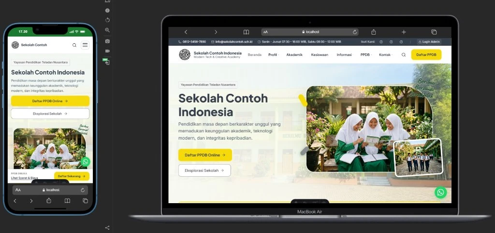

# FREEKS School Website Template 🎓

[](LICENSE)
[](https://astro.build)
[](#)

Template website sekolah modern, cepat, berbobot ringan, dan *mobile-first* yang dibangun menggunakan **Astro v5 (Static Site Generation / SSG)**. 

Dirancang khusus untuk sekolah, madrasah, pesantren, maupun akademi di Indonesia yang membutuhkan website resmi representatif, lengkap dengan fitur **Formulir PPDB Online 4 Langkah (Autosave Draft)**, **Panel Visual Pengelola Konten (Client-Side dengan Ekspor JSON)**, dan **Adapter Backend Fleksibel** yang langsung berfungsi tanpa wajib setup database (Zero-Config).

---

## 📸 Preview Tampilan



---

## 🌐 Demo Langsung

- **Live Demo**: `https://YOUR-DEMO-URL.vercel.app` *(Ganti dengan URL demo publik Anda)*
- **Demo Panel Admin**: `/admin` (Username: `admin`, Password: `123admin` — data tersimpan di peramban lokal pengunjung)

[](https://vercel.com/new/clone?repository-url=https://github.com/Faliqulxx/school_freeks)

> [!NOTE]
> **Catatan Ketentuan Lisensi Hosting Vercel Hobby:**
> Paket gratis *Vercel Hobby* diperuntukkan bagi penggunaan non-komersial/personal. Sekolah atau lembaga pendidikan yang menggunakan website ini untuk operasional resmi pendaftaran disarankan memilih hosting statis tanpa batas non-komersial seperti **Cloudflare Pages**, **Netlify**, atau menggunakan paket Vercel berbayar (Pro).

---

## ✨ Fitur Unggulan

1. **Kecepatan & Performa Ekstrem (SSG)**
   - Dibangun dengan Astro v5 menghasilkan HTML statis murni dengan *zero JavaScript overhead* di halaman konten.
   - Skor Google PageSpeed / Lighthouse 95+ untuk mobile dan desktop.

2. **Desain Mobile-First & Responsif Sempurna**
   - Diuji optimal pada lebar viewport kritis: 360px, 390px, dan 430px.
   - Navigasi header pintar dengan menu accordion multi-level, sticky banner PPDB, dan tombol aksi melayang bebas tumpang-tindih (*safe-area padding*).

3. **Formulir PPDB Online 4-Langkah (Wizard)**
   - Fitur **Autosave Draft** otomatis via `localStorage` (isian formulir calon siswa tidak hilang saat koneksi internet terputus).
   - Validasi formulir per tahap dengan ringkasan error interaktif.
   - Pembuatan Bukti Pendaftaran otomatis beserta nomor registrasi unik dan tombol konfirmasi instan ke WhatsApp panitia.

4. **Panel Admin Konten Mandiri (Client-Side)**
   - Akses `/admin` untuk mengubah profil, fasilitas, visi-misi, kurikulum, guru, pengumuman, berita, hingga pengaturan tema dan logo 3D (`.glb`).
   - Fitur **"Unduh JSON"**: Cukup edit konten di browser, unduh file JSON yang diperbarui, masukkan ke `src/data/`, dan lakukan commit git.

5. **Arsitektur Backend Opsional (Adapter Pattern)**
   - **Zero-Config Default (`"none"`)**: Bekerja seketika setelah di-clone tanpa file `.env` dan tanpa database.
   - Pilihan backend siap pakai hanya dengan menyetel variabel lingkungan:
     - `none`: Client-side localStorage + WhatsApp redirect.
     - `webhook`: Kirim pendaftaran & kontak ke Google Sheets / Google Apps Script, Make, n8n, Formspree, atau Zapier.
     - `supabase`: Simpan otomatis ke tabel Supabase via REST API dengan keamanan Row Level Security (RLS).
     - `mysql`: Teruskan data ke database MySQL / PlanetScale / TiDB via HTTP API serverless.

---

## 🚀 Memulai Cepat (Quick Start dalam 3 Langkah)

Pastikan Anda telah menginstal **Node.js** (versi 18 atau 20+).

```bash
# 1. Kloning repositori ini
git clone https://github.com/Faliqulxx/school_freeks.git
cd school_freeks

# 2. Pasang dependensi
npm install

# 3. Jalankan server pengembangan lokal
npm run dev
```

Buka peramban Anda di `http://localhost:4321/`.

---

## ⚙️ Cara Mengganti Identitas Sekolah (Pusat Konfigurasi)

Seluruh informasi sekolah dan tema warna berada di satu file terpusat: [`src/data/site.json`](file:///src/data/site.json).

```json
{
  "school": {
    "name": "Nama Sekolah Anda",
    "shortName": "SINGKATAN",
    "tagline": "Slogan atau Moto Sekolah Anda",
    "address": "Alamat lengkap sekolah Anda",
    "phone": "+62 812-xxxx-xxxx",
    "email": "kontak@sekolahanda.sch.id",
    "social": {
      "instagram": "https://instagram.com/...",
      "youtube": "https://youtube.com/@..."
    }
  },
  "theme": {
    "primaryColor": "#1E40AF",
    "accentColor": "#F59E0B",
    "logo": "/assets/logo-sekolah.webp",
    "logo3d": "/assets/3d/freeks.glb"
  }
}
```
Ubah isian di atas, dan seluruh halaman publik, header, footer, meta tag, dan formulir otomatis menyesuaikan!

---

## 📝 Cara Mengedit Data Konten Website

Terdapat 2 cara mudah untuk memperbarui isi artikel, guru, jadwal, dan galeri:

### Metode A: Melalui Panel Admin (Direkomendasikan untuk Pemula)
1. Buka halaman `http://localhost:4321/admin` di peramban Anda.
2. Masuk menggunakan akun bawaan (Username: `admin`, Password: `123admin`).
3. Pilih modul yang ingin diubah (Beranda, Profil, Akademik, Informasi, PPDB, dll.).
4. Lakukan penyesuaian data, lalu klik tombol **"Unduh JSON"** di bagian atas halaman admin.
5. Pindahkan file JSON hasil unduhan ke dalam folder `src/data/` (menggantikan file yang lama).
6. Commit perubahan ke repositori Git Anda.

### Metode B: Mengedit File JSON Langsung
Buka dan sesuaikan 17 file data yang tersusun rapi di direktori `src/data/`:
- `site.json` — Identitas sekolah & konfigurasi warna.
- `berita.json` — Daftar artikel warta dan dokumentasi kegiatan.
- `guru.json` — Daftar tenaga pendidik, foto, dan bidang pengampu.
- `fasilitas.json` — Sarana dan prasarana sekolah.
- `ppdb.json` — Informasi gelombang, alur, kuota, dan rincian biaya.
- `galeri.json`, `pengumuman.json`, `unduhan.json`, dll.

---

## 🔌 Pilihan Backend vs Layanan Hosting

Secara bawaan (*out-of-the-box*), form PPDB dan kontak berjalan dalam mode **demo** di sisi peramban (`none`). Untuk mengintegrasikannya dengan backend riil, Anda cukup menyalin file `.env.example` menjadi `.env` dan menyetel variabel `PUBLIC_BACKEND_PROVIDER`:

| Provider | Dukungan Hosting Statis (Vercel / Netlify / Cloudflare / GitHub Pages) | Kebutuhan Server | Cara Kerja Penyimpanan |
|---|---|---|---|
| **`none` (Default)** | ✅ Ya, 100% Statis | Tidak ada | Disimpan di `localStorage` peramban calon siswa + direct chat WhatsApp ke panitia PPDB. |
| **`webhook`** | ✅ Ya, 100% Statis | Tidak ada (Serverless pihak ke-3) | Data dikirim via POST JSON ke Google Sheets (via Apps Script), Make.com, n8n, atau Formspree. |
| **`supabase`** | ✅ Ya, 100% Statis | Tidak ada (Managed PostgreSQL) | Disimpan langsung ke PostgreSQL Supabase menggunakan API Key publik yang diamankan dengan *Row Level Security* (RLS). |
| **`mysql`** | ⚠️ Memerlukan Endpoint API Serverless | Server API / Cloudflare Worker / VPS | Dikirim via HTTP API proxy ke database MySQL/MariaDB sekolah. |

Panduan konfigurasi mendalam untuk masing-masing opsi dapat dilihat di:
- [Panduan Setup Backend (Webhook, Supabase, MySQL)](docs/backend-setup.md)
- [Deploy ke Vercel](docs/deploy-vercel.md)
- [Deploy ke Netlify](docs/deploy-netlify.md)
- [Deploy ke Cloudflare Pages](docs/deploy-cloudflare-pages.md)
- [Deploy ke GitHub Pages](docs/deploy-github-pages.md)

---

## 🗺️ Roadmap Pengembangan

- [x] Baseline arsitektur Astro v5 SSG dengan performa 95+.
- [x] Optimasi tampilan mobile penuh (bebas horizontal overflow & navbar accordion).
- [x] Formulir PPDB 4 tahap dengan fitur autosave draft lokal.
- [x] Panel administrasi konten visual client-side dengan ekspor JSON.
- [x] Adapter Pattern backend (None, Webhook, Supabase, MySQL).
- [x] Sanitasi data demo & isolasi konfigurasi `site.json`.
- [ ] Pilihan template tema warna preset (Hijau Madrasah, Biru Modern, Merah Akademi).
- [ ] Integrasi Payment Gateway lokal (Midtrans / Xendit) untuk pembayaran pendaftaran.
- [ ] Pengiriman notifikasi WhatsApp otomatis melalui API Fonnte / Wablas.

---

## 📄 Lisensi & Hak Cipta

Kode sumber template ini didistribusikan di bawah lisensi terbuka **[MIT License](LICENSE)** &copy; 2026 **Faliqul Ishbah**.

> [!IMPORTANT]
> **Pengecualian Merek dan Konten:**
> Lisensi MIT ini mencakup seluruh arsitektur kode sumber, modul komponen, dan utilitas perangkat lunak. **Nama merek, logo, lambang resmi, dan materi identitas intelektual asli dari FREEKS.id maupun MTS Islamiyah TIDAK termasuk dalam lisensi ini** dan tetap menjadi hak milik eksklusif pemilik masing-masing. Silakan ganti seluruh identitas dan aset gambar dengan logo dan konten sekolah Anda sendiri sebelum mempublikasikannya secara resmi.

